<p align="center">
  
</p>

<p align="center">
  <a href="https://github.com/ishandutta2007/Awesome-Awesome-Awesome"></a><a href="https://discord.gg/jc4xtF58Ve"></a>
  <a href="https://github.com/ishandutta2007/Awesome-Youtube-SEO-Optimization/stargazers"></a>
  <a href="https://github.com/ishandutta2007/Awesome-Youtube-SEO-Optimization/network/members"></a>
  <a href="https://github.com/ishandutta2007/Awesome-Youtube-SEO-Optimization/blob/main/LICENSE"></a>
  <a href="https://github.com/ishandutta2007/Awesome-Youtube-SEO-Optimization/pulls"></a>
  <a href="https://github.com/ishandutta2007"></a>
</p>

# 🚀 Awesome YouTube SEO & Optimization Ecosystem

> 🎯 **A definitive, community-curated directory of SaaS intelligence platforms, open-source toolkits, and automation workflows engineered for YouTube SEO, keyword discovery, metadata optimization, and creator channel growth.**

Welcome to the **Awesome YouTube SEO & Optimization** resource center! In today's competitive video landscape, discoverability dictates channel velocity. Whether you are an independent creator searching for high-traffic long-tail keywords, a growth marketer optimizing video click-through rates (CTR) and average view duration (AVD), or an engineer developing self-hosted SEO agents via the Model Context Protocol (MCP), this repository aggregates the most battle-tested tools and frameworks.

---

## 📑 Table of Contents

- [📊 Sector Overview & Market Dynamics](#-sector-overview--market-dynamics)
- [🏢 SaaS & Hosted Commercial Platforms](#-saas--hosted-commercial-platforms)
- [💻 Open-Source GitHub Projects](#-open-source-github-projects)
- [🛠️ Architecture: Building a Self-Hosted SEO Stack](#️-architecture-building-a-self-hosted-seo-stack)
- [💡 YouTube Algorithm & SEO Optimization Playbook](#-youtube-algorithm--seo-optimization-playbook)
- [🤝 How to Contribute](#-how-to-contribute)
- [🌟 Star History](#-star-history)
- [💖 Support](#-support)
- [📜 Disclaimer](#-disclaimer)

---

## 📊 Sector Overview & Market Dynamics

The global video and search engine optimization (SEO) software market is currently valued between **$7.5B and $10.5B**, driven by the broader expansion of the **$250B+ Creator Economy** and the migration of search habits toward rich multimedia and AI-assisted engines. 

The sector features a **moderately concentrated structure at the enterprise and flagship tier**—where cross-search intelligence leaders (*Semrush*, *Ahrefs*) and dedicated YouTube creator giants (*vidIQ*, *TubeBuddy*) dominate user share and enterprise creator spend—alongside a **highly fragmented long-tail** of niche keyword extractors, AI metadata co-pilots, browser extensions, and self-hosted open-source MCP toolkits addressing creators demanding data sovereignty, zero subscription overhead, and private LLM integration.

---

## 🏢 SaaS & Hosted Commercial Platforms

The table below outlines leading commercial YouTube SEO solutions, sorted descending by company scale (market capitalization, enterprise valuation, or annual recurring revenue):

| 🏷️ Tool / Platform | 🏢 Company Scale (Rev / Valuation) | 💵 Starting Tier Price | 🎁 Free Tier Limits / Free Trial | ⚡ Core Focus & Capabilities |
| :--- | :--- | :--- | :--- | :--- |
| **[Semrush](https://www.semrush.com/)** | **Public (NYSE: SEMR)**<br>~$1.8B+ MCap / ~$356M ARR | **$139.95/mo**<br>*(or $117.33/mo billed annually)* | **Free Forever Account**:<br>10 searches/day, 1 project, 10 tracked keywords, basic domain & keyword overview | Enterprise-grade digital marketing suite with YouTube keyword explorer, SERP tracking, competitor video visibility, and AI search presence monitoring. |
| **[Ahrefs](https://ahrefs.com/)** | **Private Bootstrapped**<br>~$1.0B+ Valuation / ~$120M+ ARR | **$29.00/mo** (Starter)<br>*(or $129.00/mo / $108/mo ann. for Lite)* | **Free Forever (Ahrefs Webmaster Tools)**:<br>Verified domains only, 5,000 crawl credits/mo, top 1,000 keywords/backlinks visible | Comprehensive keyword index with YouTube-specific search volume, keyword difficulty scores, and cross-channel Google/YouTube search intent. |
| **[vidIQ](https://vidiq.com/)** | **Private VC-Backed**<br>~$100M+ Valuation / ~$15M–$25M ARR | **$19.00/mo** (Boost)<br>*(or $16.58/mo billed annually)* | **Free Forever Plan**:<br>150 AI credits/mo, 3 daily AI content ideas, track 3 competitor channels, basic browser extension stats overlay | YouTube creator discovery platform specializing in outlier view detection, views-per-hour (VPH) velocity, AI title/description generators, and trend alerts. |
| **[TubeBuddy](https://www.tubebuddy.com/)** | **Subsidiary of GameSquare (NASDAQ: GAME)**<br>~$10M–$15M ARR | **$12.00/mo** (Pro)<br>*(starts at $3.60–$4.50/mo for &lt;1K subs)* | **Free Forever Plan**:<br>1 channel access, basic video scorecard, tag suggestions, and Keyword Explorer capped at top 3 results | Deep YouTube Studio browser integration, bulk metadata editing, automated thumbnail A/B testing, and comprehensive upload SEO checklists. |
| **[KeywordTool.io](https://keywordtool.io/)** | **Private Bootstrapped**<br>~$3M–$5M ARR | **$89.00/mo** (Pro Basic)<br>*(or $69.00/mo billed annually)* | **Free Forever Plan**:<br>Raw YouTube autocomplete keyword suggestions only (search volume, CPC, and trend data masked; 30-day money-back guarantee) | International autocomplete discovery scraping real-time YouTube search suggestions across 192 countries and localized languages. |
| **[RankTracker](https://www.link-assistant.com/rank-tracker/)** | **Private (SEO PowerSuite)**<br>~$2M–$5M ARR | **$349.00/year** (Professional)<br>*(~$29.08/mo equivalent)* | **Free Forever Desktop Edition**:<br>Unlimited keyword rank checks without caps, project saving/loading disabled, reports watermarked, 500 URLs crawl limit | Desktop software suite for unmetered local YouTube SERP rank tracking, competitor ranking checks, and scheduled SERP monitoring without API subscription fees. |
| **[TuBeast](https://tubeast.com/)** | **Private Bootstrapped**<br>~$500K–$1M ARR | **$47.00/mo** (Standard)<br>*(scales to $97/mo Premium)* | **Free Forever Starter Tier**:<br>3 keyword searches/day, basic video tag extractor, advanced channel analytics & AI recommendations locked | Automated video SEO analysis, competitor topic gap research, and metadata scoring tailored for channel discoverability. |
| **[TubeRanker](https://tuberanker.com/)** | **Private Bootstrapped**<br>~$500K–$1M ARR | **$19.00/mo** (Basic)<br>*(or $9.90/mo billed annually)* | **Free Forever Tools**:<br>Light tag generator & channel audit utilities with strict usage caps (~5 lookups/mo; 14-day refund window on paid plans) | Modular online utility suite for YouTube tag extraction, hashtag generation, channel SEO health audits, and video title generators. |
| **[TubeSpanner](https://tubespanner.com/)** | **Early Stage / Seed**<br>~$300K–$600K ARR | **$14.99/mo** (Core)<br>*(or $12.49/mo billed annually)* | **Free Forever Plan**:<br>30 video ideas & titles/mo, 2 video scripts/mo, 2 thumbnail designs/mo, 1 personal creator bio page (resets monthly) | Creator workflow management platform fusing SEO ideation, scriptwriting assistants, AI thumbnail generators, and social publishing schedules. |
| **[Morningfame](https://morningfa.me/)** | **Private Bootstrapped**<br>~$200K–$500K ARR | **$4.90/mo** (Basic)<br>*(or $3.90/mo billed annually)* | **Invite-Only 30-Day Free Trial**:<br>Full access to analytics & keyword research for 30 days via invite link (no permanent free tier; Basic limits keyword tool to 24h per 12 days) | Guided 4-step keyword search optimization, thumbnail search card contrast testing, and transparent channel momentum analytics. |

---

## 💻 Open-Source GitHub Projects

Explore verified open-source YouTube SEO repositories, CLI utilities, and MCP servers. Repositories are sorted descending by GitHub star count:

- **[claude-youtube](https://github.com/AgriciDaniel/claude-youtube)** [](https://github.com/AgriciDaniel/claude-youtube/stargazers)  
  Comprehensive Claude Code skill suite for YouTube creators covering end-to-end channel audits, video SEO metadata, retention scripts, thumbnail concepts, Shorts strategy, and monetization analytics.

- **[youtube-marketing-skills](https://github.com/adityaarsharma/youtube-marketing-skills)** [](https://github.com/adityaarsharma/youtube-marketing-skills/stargazers)  
  Agent-agnostic YouTube growth toolkit featuring 21 AI commands and a live channel MCP server. Compatible with Claude Code, Cursor, Codex, Windsurf, and Gemini CLI. Integrates DataForSEO MCP for live YouTube SERP metrics, keyword volumes, and competitor gap auditing.

- **[youtube-skills](https://github.com/sergebulaev/youtube-skills)** [](https://github.com/sergebulaev/youtube-skills/stargazers)  
  YouTube and Shorts marketing skills suite for LLM agents (Claude Code, Codex) focused on high-CTR title engineering, SEO-optimized descriptions, retention hooks, thumbnail briefs, and publishing calendars.

- **[Youtube2Blog](https://github.com/badboysm890/Youtube2Blog)** [](https://github.com/badboysm890/Youtube2Blog/stargazers)  
  AI-powered content repurposing engine converting YouTube video transcripts into SEO-optimized, publication-ready blog posts and long-form web content to capture cross-platform search traffic.

- **[YoutubeTags](https://github.com/nuhmanpk/YoutubeTags)** [](https://github.com/nuhmanpk/YoutubeTags/stargazers)  
  Fast, lightweight YouTube SEO utility for extracting hidden tags, keywords, and metadata directly from public video URLs without requiring Google Cloud credentials or consuming API quotas.

- **[youtube-mcp-server](https://github.com/pauling-ai/youtube-mcp-server)** [](https://github.com/pauling-ai/youtube-mcp-server/stargazers)  
  Full-featured Model Context Protocol (MCP) server exposing 40 tools covering YouTube Data API v3, Analytics API, and Reporting API for programmatic video SEO discovery, transcript extraction, and audience insights.

- **[youtube-analytics-bot](https://github.com/Prem-ium/youtube-analytics-bot)** [](https://github.com/Prem-ium/youtube-analytics-bot/stargazers)  
  Discord bot and automated monitoring agent that tracks channel statistics, view velocity metrics, subscriber trajectories, and delivers real-time performance alerts to creator communities.

- **[Awesome-youtube-ai-tools](https://github.com/signuphere88/Awesome-youtube-ai-tools)** [](https://github.com/signuphere88/Awesome-youtube-ai-tools/stargazers)  
  Curated list of AI engines, SEO scripts, and automated creation pipelines designed for indie video creators and technical channel operators.

- **[Advanced-Youtube-Seo-Generator-2.0](https://github.com/Avinashricky211/Advanced-Youtube-Seo-Generator-2.0)** [](https://github.com/Avinashricky211/Advanced-Youtube-Seo-Generator-2.0/stargazers)  
  Python automation script leveraging the YouTube Data API to analyze high-performing competitor tags, evaluate keyword density, and generate structured titles, descriptions, and hashtags.

- **[Aurora](https://github.com/bvbvbv54/Aurora)** [](https://github.com/bvbvbv54/Aurora/stargazers)  
  Evidence-first YouTube keyword research automation featuring recursive search autocomplete scraping, VidIQ all-history velocity curves, AI thumbnail scoring, and Goldmine high-opportunity keyword alerts.

- **[VAI0](https://github.com/Number16BusShelter/VAI0)** [](https://github.com/Number16BusShelter/VAI0/stargazers)  
  AI CLI utility that extracts video audio, generates multilingual subtitles via Whisper, and produces SEO-optimized YouTube titles and markdown descriptions using local Ollama models.

- **[Clipmark](https://github.com/santoslopez7970-sys/ClipMark)** [](https://github.com/santoslopez7970-sys/ClipMark/stargazers)  
  High-performance YouTube video processing application extracting transcripts, chapters, tags, and SEO metadata via native YouTube APIs built on Next.js, Redis, and MongoDB without AI latency.

- **[reach-optimiser](https://github.com/avirajpaul5/reach-optimiser)** [](https://github.com/avirajpaul5/reach-optimiser/stargazers)  
  React and TypeScript web application that audits and scores YouTube video metadata for SEO quality, offering AI-generated optimization recommendations powered by Groq and Supabase.

- **[Youtube-Keyword-Scraper](https://github.com/mod-hamza/Youtube-Keyword-Scraper)** [](https://github.com/mod-hamza/Youtube-Keyword-Scraper/stargazers)  
  Selenium WebDriver automated scraper collecting video titles, view counts, publish recency, duration, and channel subscriber counts into MySQL for bespoke competitive intelligence.

- **[RankTube](https://github.com/mjgit007/ranktube)** [](https://github.com/mjgit007/ranktube/stargazers)  
  Open-source YouTube keyword research ranker featuring a dedicated web interface (`rt-ui`), match-quality relevance algorithms, and JSON export modes utilizing the free YouTube Data API quota.

---

## 🛠️ Architecture: Building a Self-Hosted SEO Stack

For technical creators and development teams seeking to avoid ongoing per-seat SaaS costs while preserving complete data sovereignty, combine these open-source building blocks:

```
┌─────────────────────────────────────────────────────────────┐
│                 Creator Terminal / Agent IDE                │
│            (Claude Code / Cursor / Gemini CLI)              │
└──────────────┬──────────────────────────────┬───────────────┘
               │                              │
               ▼                              ▼
┌──────────────────────────────┐┌──────────────────────────────┐
│ youtube-marketing-skills     ││ pauling-ai/youtube-mcp-server│
│ (21 AI Commands & Workflows) ││ (40 API Tools & Analytics)   │
└──────────────┬───────────────┘└──────────────┬───────────────┘
               │                              │
               ▼                              ▼
┌──────────────────────────────┐┌──────────────────────────────┐
│ DataForSEO MCP / Scrapers    ││ Local LLM (Ollama / VAI0)    │
│ (Live Search Volume & SERP)  ││ (Metadata & Caption Gen)     │
└──────────────────────────────┘└──────────────────────────────┘
```

1. **AI Agent Interface**: Use [youtube-marketing-skills](https://github.com/adityaarsharma/youtube-marketing-skills) for competitor gap analysis (`/youtube-competitor`) and keyword-ranked ideation (`/youtube-ideate`).
2. **API & Data Layer**: Connect [youtube-mcp-server](https://github.com/pauling-ai/youtube-mcp-server) for automated channel metrics and transcript extraction.
3. **Keyword Ranking**: Deploy [RankTube](https://github.com/mjgit007/ranktube) for match relevance scoring and [YoutubeTags](https://github.com/nuhmanpk/YoutubeTags) for tag intelligence.
4. **Local AI Inference**: Run [VAI0](https://github.com/Number16BusShelter/VAI0) with Whisper and Ollama for cost-free captioning, chapter markers, and multilingual SEO descriptions.

---

## 💡 YouTube Algorithm & SEO Optimization Playbook

To maximize your organic reach across YouTube Search, Suggested Videos, and Browse features:

1. **🎯 Keyword Intent Mapping**: Focus long-tail keyword research on user intent. Match high-volume autocomplete queries to solve specific viewer problems.
2. **📈 Click-Through Rate (CTR) Drivers**: Optimize the first 50 characters of your video title for clarity and emotional resonance. Pair with high-contrast thumbnails (tested on mobile dark mode).
3. **⏱️ Retention & Engagement (AVD)**: The algorithm prioritizes Average View Duration and Percentage Viewed. Incorporate strong pattern interrupts in the first 30 seconds.
4. **📝 Structured Description Hierarchy**: Place core target keywords naturally within the first two sentences. Include timestamped chapter markers to capture Google SERP key moments.
5. **🏷️ Metadata & Tag Relevance**: Use 5–8 tightly targeted tags reflecting exact search terms, category keywords, and channel branding rather than generic keyword stuffing.

---

## 🤝 How to Contribute

Contributions from creators, researchers, and developers are warmly welcomed!

1. 🍴 **Fork the Repository** on GitHub.
2. 🌿 **Create a Feature Branch** (`git checkout -b feature/add-new-seo-tool`).
3. ✍️ **Add or Update Entries**: Maintain alphabetical or star-based sorting, include factual pricing/limits, and link directly to official repositories or homepages.
4. 🚀 **Submit a Pull Request** with a concise description of your changes.

Please review our [Awesome Guidelines](https://github.com/ishandutta2007/Awesome-Awesome-Awesome) before submitting.

---

## 🌟 Star History

[](https://star-history.dera.page/#ishandutta2007/Awesome-Youtube-SEO-Optimization&type=date&legend=top-left)

---

## 💖 Support

If this curated YouTube SEO ecosystem guide has helped you streamline your video workflow, find the right software, or grow your channel, please consider supporting the project:

- ⭐ **Star this repository** to help other creators and developers discover it.
- 🍴 **Fork and share** the project with your creator networks and growth communities.
- ☕ **Sponsor the maintainer**: Support ongoing curation and open-source updates via the [GitHub Sponsors Dashboard](https://github.com/sponsors/ishandutta2007).

<p align="center">
  <a href="https://github.com/sponsors/ishandutta2007">
    
  </a>
</p>

---

## 📜 Disclaimer

- *This repository is a community-curated directory compiled for educational and research purposes. Product names, logos, and brands are property of their respective owners.*
- *All tools and scrapers must be operated in accordance with the [YouTube Terms of Service](https://www.youtube.com/t/terms) and applicable API quotas.*
